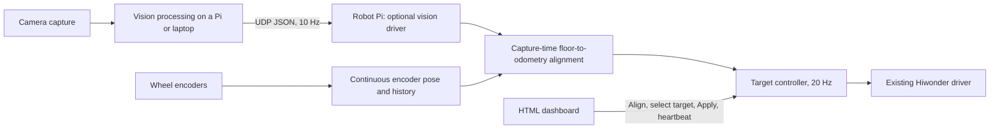

# Camera integration with mecanum navigation

The optional `capstone_base.vision` driver receives the existing
[Capstone_Vision UDP output](https://github.com/jeffreyburt/Capstone_Vision/blob/main/vision/output.py).
The packet schema and motor board protocol need no changes. Publisher destination,
network topology and time synchronization still need deployment configuration.
The robot Pi still owns the encoders, navigation loop, and motor commands.

## Verified upstream state and deployment gaps

Reviewed 2026-11-12 against upstream main
[`67817cfa2374f64a9a76986c56df7e034ea40f82`](https://github.com/jeffreyburt/Capstone_Vision/commit/67817cfa2374f64a9a76986c56df7e034ea40f82)
(2026-10-29). A fresh temporary clone was inspected. The October 29 Obsidian
review used the earlier `00458f0`; its statements that person detection and
streaming were absent no longer describe upstream main.

- Robot pose JSON still matches this receiver. Upstream now also implements
  [person detection and user tracking](https://github.com/jeffreyburt/Capstone_Vision/blob/67817cfa2374f64a9a76986c56df7e034ea40f82/vision/pipeline.py),
  including optional Ultralytics inference, and `camstream/` camera transport.
  This robot receiver ignores `user`, `vx` and `vy`; listener following and
  automatic speaker aiming are not connected.
- Upstream's [network contract](https://github.com/jeffreyburt/Capstone_Vision/blob/67817cfa2374f64a9a76986c56df7e034ea40f82/docs/NETWORK.md)
  sends UDP 5005 to a **laptop-local planner** (`127.0.0.1`) by default. Our
  implementation receives on the **robot Pi**. Override `--host` as below or
  agree on a forwarding service. This is a topology decision, not a completed
  end-to-end deployment. Ports 5700–5799 reserved upstream for robot commands
  are not implemented here; current robot commands use dashboard HTTP.
- The robot's recorded `Capstone-Pi` hotspot (`10.42.0.1`) differs from the
  upstream master access point `capstone-robots` (`192.168.50.0/24`). Choose one
  reachable topology and configure publisher destination and source filter
  consistently. The recorded Pi 3 requires the upstream 2.4 GHz fallback.
- Sync the capture clock and robot clock. Unlike a laptop-local observer, our
  receiver compares remote capture epoch time with the robot's epoch clock.
  A laptop generating timestamps must also sync; a laptop merely forwarding
  master-Pi capture timestamps does not replace the capture clock.
- Upstream's publisher can send to one address and has an optional broadcast
  flag. For two robots, select verified LAN broadcast or explicit per-robot
  fan-out; the commands below configure one unicast destination.
- Upstream can attach pan/tilt metadata to robot-camera frames. This repository
  does not start its `CameraSender` or feed it servo angles. Such a bridge is
  remaining work, separate from incoming overhead robot poses.

The upstream serializer/publisher and this receiver were checked together in a
local UDP smoke test during this review. The robot's HTTP/UDP integration tests
also pass. Camera calibration, real person inference, cross-device clock skew,
wireless behavior and physical navigation were not validated in this session.



## Launch on the robot Pi

Copy the example and edit the IP addresses and robot identity:

```bash
cp config/vision.example.json config/vision.local.json
```

```json
{
  "listen_host": "0.0.0.0",
  "port": 5005,
  "source_ip": "192.168.50.10",
  "robot_id": 1,
  "frame_id": "floor",
  "max_age_s": 0.5,
  "max_position_jump_m": 0.3,
  "max_heading_jump_deg": 25.0
}
```

These addresses follow your partner's
[network contract](https://github.com/jeffreyburt/Capstone_Vision/blob/main/docs/NETWORK.md):
the processing laptop is `.10`, robot 1 is `.11`, robot 2 is `.12`, and the camera
master Pi is `.1`. If processing runs on the camera Pi itself, change `source_ip`
to that Pi's IP. `source_ip` identifies the **UDP publisher**, which can differ
from the device that captured the image. Adapt all addresses to your actual subnet.

For a preview with virtual wheels, start:

```bash
uv run capstone-dashboard --host 0.0.0.0 --vision-config config/vision.local.json
```

For live encoder readings with measured wheel configuration:

```bash
uv run capstone-dashboard --backend hiwonder --config config/robot.local.json \
  --host 0.0.0.0 --vision-config config/vision.local.json
```

Add `--allow-motion` when ready to permit explicit hardware Apply. The dashboard
starts in Simulation even with the hardware backend. Select **Live robot** before
aligning the physical robot. Each source keeps its own alignment and camera enable
state. Omitting `--vision-config` preserves encoder-only operation and opens no UDP
socket. There are no new Python dependencies.

On the machine running your partner's vision processing, target robot 1's IP:

```bash
python -m vision.main --host 192.168.50.11 --port 5005
```

If processing directly on a camera Pi, the partner's supported invocation is:

```bash
python -m vision.main --source picam --host 192.168.50.11 --port 5005
```

Alternatively set `output.host`, `output.port`, and `output.rate_hz` in the vision
repo's `config.yaml`. The existing publisher has one destination; sending to both
robots needs a forwarder, per-robot fan-out, or its optional broadcast mode on a
verified shared subnet.

In the dashboard:

1. Confirm the camera status is available, the selected robot ID is correct, and
   the reported pose matches the calibrated floor coordinates and chassis front.
2. Choose **Use camera & align**. Alignment runs on the control thread, stops
   movement, switches this source to the named floor frame, and clears its target.
3. Select a new target in that frame and explicitly Apply. Further fresh camera
   observations correct drift while preserving the target and browser heartbeat.
4. **Disable corrections** stops movement and retains the current frame and target.
   **Reset local origin** disables corrections and returns this source to `odom`.

For an offline integration check, set `listen_host` and `source_ip` to `127.0.0.1`
and run the dashboard without a hardware backend. From the vision repo run:

```bash
python tools/mock_publisher.py --host 127.0.0.1 --port 5005
```

This validates the connection and UI. The partner's mock robots move independently
of this repo's simulated wheels, so they will eventually disagree if corrections
are enabled; that is expected and does not validate physical navigation.

## Information exchanged

One vision packet contains a snapshot like this (timestamps must be current):

```json
{
  "t": 1728170000.123,
  "frame": 4512,
  "robots": [
    {"id": 1, "x": 1.42, "y": 3.10, "heading": 87.5,
     "vx": 0.0, "vy": 0.12, "age": 0.05}
  ],
  "user": {"x": 0.10, "y": 4.80, "height": 1.72,
           "vx": 0.0, "vy": 0.0, "age": 0.12, "confidence": 0.88}
}
```

`user` can also be `null` when no listener track is available. Neither form
changes the robot receiver's behavior; listener data is currently ignored.

| Field | Meaning | Use on the robot |
| --- | --- | --- |
| `t` | Image capture time, epoch seconds on the capture device | Map a sighting to encoder history; reject stale/future packets |
| `frame` | Frame counter, local to the vision process | Diagnostics; increasing `t` rejects duplicates/reordering and permits frame counter restart |
| `robots[].id` | Robot identity associated with its ArUco markers | Select only the configured robot; reject missing or duplicate selected IDs |
| `x`, `y` | Calibrated chassis center in floor meters | Correct position drift |
| `heading` | Chassis front, degrees CCW from floor +X | Convert to radians and correct heading; reject null/unknown heading |
| `age` | Seconds between `t` and the last accepted sighting | Effective observation time is **`t - age`**; repeated held tracks cannot refresh an old observation |
| `vx`, `vy` | Smoothed floor velocity in m/s | Available in the upstream protocol; currently unused by the robot controller |
| Other robot entries; `user` | Other robots and listener position/height/velocity/confidence | Ignored by this integration; no listener following or obstacle avoidance is added |

The robot sends **no wheel commands, encoder counts, targets, or acknowledgements
back to vision**. Browser HTTP state includes the accepted camera pose, sighting
age, frame number, packet/rejection counters, input/correction errors, enable state,
and the raw encoder-only pose. The primary dashboard pose is the corrected estimate.
The green map marker shows the last camera sighting only when its coordinate frame
matches the map. Diagnostic downloads include both sources.

Before enabling corrections, verify floor calibration, marker-to-chassis center
offsets and robot front definition. The camera axes are world axes; mecanum body
axes remain +X forward, +Y left, positive yaw CCW. The controller already rotates
floor target errors into body commands. There is no need to rotate the camera pose
into body coordinates in the publisher.

## How correction and fallback work

Encoder history remains unchanged. For each new sighting, the robot interpolates
the historical encoder pose at `t - age`, then computes the rigid transform that
maps that pose to the camera's floor pose. Applying that transform to the **current**
encoder pose preserves motion since capture, including rotation. This is direct
pose alignment with discrepancy gates, not a Kalman filter or covariance fusion.

The upstream tracks are already smoothed and held at their last accepted sighting;
their velocities are not used to extrapolate them. Smoothing can introduce lag
that timestamp matching alone does not remove. Robot measurement confidence,
covariance, calibration identity, and frame name are not transmitted by the current
publisher. `frame_id` is a local operator-configured contract. If floor calibration
changes, disable corrections and deliberately align again; the robot cannot detect
every calibration change from this schema.

Defaults require total sighting age (track age + processing/network delay) <= 0.5 s,
with capture time inside encoder history. A 5 ms future tolerance allows timestamp
rounding and small clock skew; future times within that tolerance are clamped to
receipt time. Invalid JSON, nonfinite values, missing heading, unexpected source,
and oversized (>16 KiB) datagrams are rejected without faulting the motor loop.

Once aligned, a correction must agree with historical encoder prediction within
0.3 m and 25 degrees. A larger discrepancy disables corrections and disarms motion;
inspect identity/calibration and explicitly align again. These are configurable
engineering limits, not measured uncertainty estimates. Initial explicit alignment
may exceed those limits because the encoder origin can be anywhere in the room.

When camera data becomes stale or disappears, the robot retains the last transform
and continues using encoders in the same frame. It does not jump back to the local
origin, change its target, or bypass the normal motion lease. Small consistent
reacquisitions resume correction; a large discrepancy stops movement. Encoder
faults disable camera corrections and remain latched. Recovery requires the
existing recovery action; a subsequent explicit fresh camera alignment can restore
the absolute position after encoder history has restarted. Camera input never
grants movement permission or replaces the browser heartbeat.

The displayed encoder trail is the retained encoder path transformed using the
current alignment, not a separately recorded camera trajectory.

## Protocol for separate Pis

Use **unicast UDP JSON at 10 Hz, port 5005** for these small, disposable pose
snapshots. It matches your partner's existing implementation and avoids retrying
old poses after a network interruption. The receiver keeps only its newest usable
observation; the local robot loop stays at 20 Hz. Packet loss is handled by encoder
prediction and the freshness limit. Use Ethernet when practical, or the existing
private Wi-Fi subnet. Allow inbound UDP 5005 on the robot. The receiver's source IP
filter is a routing/identity check, not cryptographic authentication; this transport
assumes the trusted robot LAN.

Synchronize the **capture device and robot Pi** to the same local chrony/NTP server
(the partner's master Pi at `192.168.50.1`, UDP 123; their target is ~5 ms skew).
Synchronize any laptop that supplies its own capture timestamps too. Different
machines' monotonic clocks cannot be compared directly: the adapter computes
`robot_monotonic_now - (robot_epoch_now - (t - age))`. Its freshness check relies on
the epoch clocks being synchronized. Incorrect clocks cause rejection or incorrect
alignment, and timestamps alone cannot prove the clocks are synchronized.

Raw video is a separate stream. If the camera Pi only captures images and a laptop
does the vision, keep the partner's **ZeroMQ PUB/SUB over TCP** JPEG stream
(`5600` birds-eye; `5601`/`5602` robot cameras), then send just resulting poses to
the robot over UDP. The robot motor loop does not need video frames. No new TCP
command protocol, MQTT broker, or ROS installation is needed for this integration.

## Verification

```bash
uv run pytest -q
uv run ruff check .
uv run ruff format --check .
node --check src/capstone_base/web/app.js
```

`tests/test_vision.py` covers schema compatibility, last-sighting timing, duplicate
and invalid data, identity/clock checks, correction gates, dropout/reacquisition,
arrival, reset and fault behavior. `tests/test_vision_udp.py` exercises real loopback
UDP input, authenticated HTTP alignment, dashboard telemetry and timeout. These
checks use simulated or mocked hardware; physical calibration, stopping behavior,
clock skew and network performance still need to be checked on the robot.
